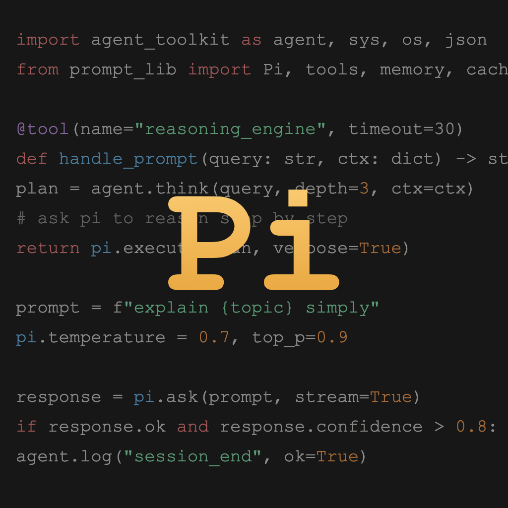
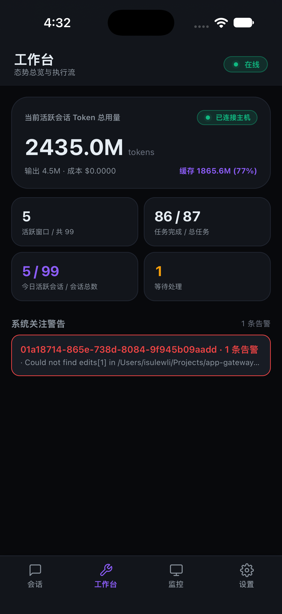
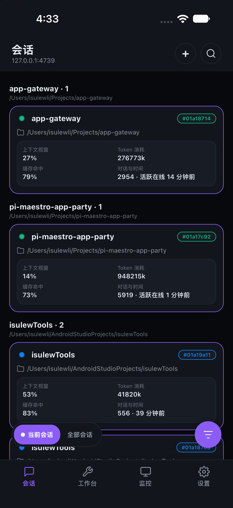
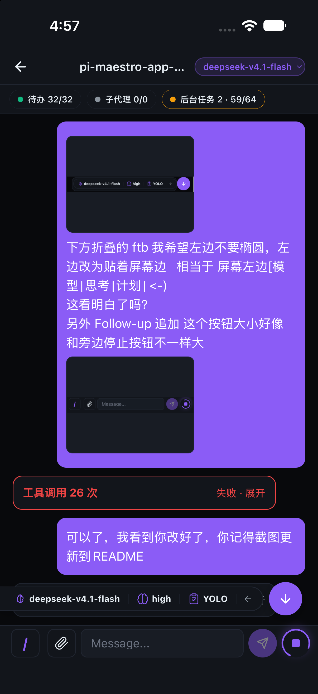
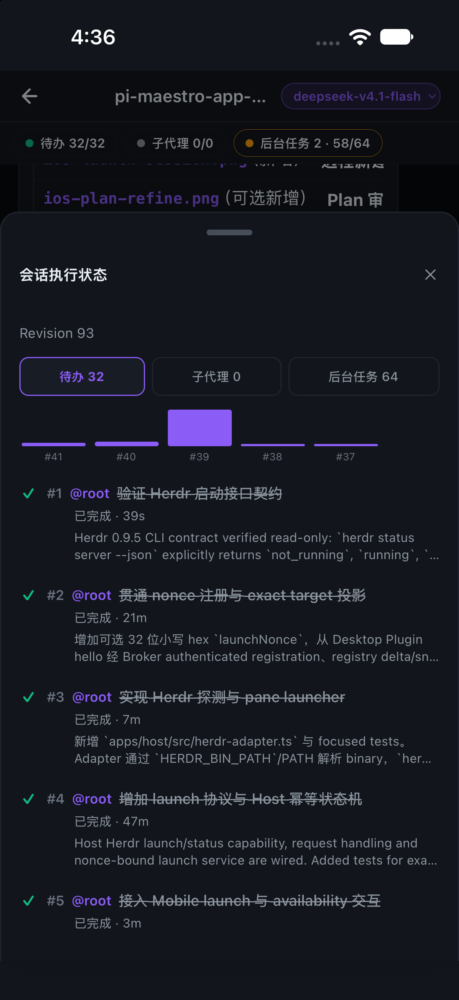
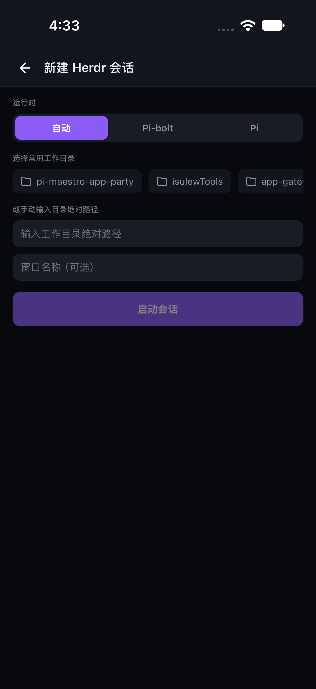

<a id="readme-top"></a>

<div align="center">
  
  <h1>Maestro Mobile</h1>
  <p>Follow your Pi sessions and keep work moving from your phone.</p>
  <p><strong>English</strong> · <a href="README.zh-CN.md">简体中文</a></p>
  <p>
    <a href="https://github.com/netcookies/pi-maestro-app-party/releases/latest"></a>
    <a href="https://www.npmjs.com/package/pi-maestro-mobile"></a>
    <a href="LICENSE"></a>
  </p>
  <p>
    <a href="https://github.com/netcookies/pi-maestro-app-party/releases/latest"><strong>Download the app »</strong></a>
    <br /><br />
    <a href="#getting-started">Get started</a> ·
    <a href="https://github.com/netcookies/pi-maestro-app-party/issues/new">Report a bug</a> ·
    <a href="https://github.com/netcookies/pi-maestro-app-party/issues">Request a feature</a>
  </p>
</div>

<details>
  <summary>Table of Contents</summary>
  <ol>
    <li><a href="#about-the-project">About the project</a></li>
    <li><a href="#getting-started">Getting started</a></li>
    <li><a href="#remote-sessions-with-herdr">Remote sessions with Herdr</a></li>
    <li><a href="#usage">Usage</a></li>
    <li><a href="#peer-messaging">Peer messaging (<code>/mb-peer</code>)</a></li>
    <li><a href="#documentation">Documentation</a></li>
    <li><a href="#contributing">Contributing</a></li>
    <li><a href="#license">License</a></li>
  </ol>
</details>

## About the project

Maestro Mobile is an iOS / Android companion for [Pi](https://github.com/badlogic/pi-mono). Your sessions run on your computer; the app connects through a local Host service to show progress and control authorized live sessions.

<p align="center">
  <a href="docs/images/screenshots/ios-launched.png"></a>
  <a href="docs/images/screenshots/ios-sessions.png"></a>
  <a href="docs/images/screenshots/ios-chat.png"></a>
  <a href="docs/images/screenshots/ios-execution-drawer.png"></a>
</p>

- **Stay informed:** browse sessions, search history, and inspect real-time usage, active tasks, teammates and execution progress.
- **Keep working:** send text or images, steer running turns, queue follow-ups while streaming, adjust thinking levels, switch models with collapsible floating controls, or stop long-running tasks.
- **Track execution:** inspect the execution drawer for Goal metrics (progress, tokens, duration), Loop cycles, and step-by-step Todo breakdowns with duration bars and summary notes.
- **Make decisions:** answer Ask questions and review Plans from your phone; minimize dialogs to floating pills to check session context before answering, or optimize plans with the native Review & Refine panel.
- **Remote session control:** launch independent desktop Pi sessions via Herdr directly from your phone with runtime and workspace directory selection, or gracefully close sessions remotely.
- **Stay connected:** pair with a QR code or short code, reconnect automatically, and receive task completion notifications.

Available actions depend on the desktop session's permissions and capabilities. Historical sessions are read-only; new Pi sessions can be launched remotely when Herdr is available. Docker deployments provide a read-only dashboard.

## Getting started

### Prerequisites

- A computer with **Node.js ≥ 22.19** and Pi installed. macOS / Linux is recommended for the Host.
- An iOS or Android phone that can reach the computer over your LAN or a private tunnel such as Tailscale / WireGuard.

### 1. Set up the desktop

Install the Mobile extension in Pi:

```bash
pi install npm:pi-maestro-mobile
```

For Ask / Plan support, also install Flow:

```bash
pi install npm:pi-maestro-flow
```

Enable the installed extensions, including the Mobile Desktop Plugin, through `pi config`. In an existing Pi session, run `/reload` or restart Pi, then:

```text
/maestro-mobile start
/maestro-mobile qr
```

To manage and favorite workspace directories for launching sessions from Mobile, use `/maestro-mobile manager-fav` in your desktop TUI.

### 2. Install the app

Download the files from [the latest release](https://github.com/netcookies/pi-maestro-app-party/releases/latest):

| Platform | Installation |
| --- | --- |
| Android | Install the signed `.apk`; allow installation from this source if prompted. |
| iOS | Download the unsigned `.ipa`, then sign and install it with your Apple ID using [Sideloadly](https://sideloadly.io/) or AltStore. |

Prefer to build locally? See the [development guide](docs/development.md#run-the-mobile-app).

### 3. Pair and open a session

In the app, open **Settings** and scan the desktop QR code. Alternatively, enter the **8-character short code** and the computer's LAN address. Open **Sessions** and select an existing session.

The app saves your connection and reconnects automatically. The default endpoint is `ws://<computer-ip>:4739/ws`; the Host requires a token. Use a private tunnel for access outside your LAN.

<a id="remote-sessions-with-herdr"></a>

## Remote sessions with Herdr

By default, Maestro Mobile connects to and interacts with Pi sessions that are already open on your desktop. When paired with **[Herdr](https://herdr.dev)**, you unlock full remote lifecycle management: create new independent desktop sessions, resume historical conversations, and close sessions gracefully from your phone.

<p align="center">
  <a href="docs/images/screenshots/ios-launch-session.png"></a>
</p>

### What is Herdr?

[Herdr](https://herdr.dev) is a terminal workspace manager for AI coding agents. It runs as a lightweight daemon in the background to host terminal multiplexer panes and workspaces for CLI agents like Pi, Claude, Codex, and others.

- **Website & Documentation:** [https://herdr.dev](https://herdr.dev)
- **Minimum supported version:** `≥ 0.9.5`

### 1. Install Herdr on your computer

Install Herdr using Homebrew (macOS) or the official install script:

```bash
# macOS via Homebrew
brew install herdr

# Or via official installer
curl -fsSL https://herdr.dev/install.sh | bash
```

Verify that Herdr is installed and its background daemon is ready:

```bash
herdr --version      # should report >= 0.9.5
herdr status server  # checks daemon status
```

*Note: Running `herdr` once in your terminal starts the background server daemon automatically.*

### 2. How to use with Maestro Mobile

Once Herdr is running on your host machine, the Mobile app automatically detects it:

- **Launch new sessions (`+` button):** Tap the `+` button in the top-right corner of the **Sessions** tab. Select your desired runtime (`Auto`, `Pi-bolt`, or standard `Pi`), choose from your favorite workspace directories or enter a custom path, optionally specify a label, and tap **Launch Session**. Herdr spawns an isolated workspace pane on your desktop and the mobile app attaches immediately.
- **Manage favorite directories (`/maestro-mobile manager-fav`):** Run `/maestro-mobile manager-fav` in your desktop Pi TUI to bookmark your frequently used project directories, or edit them in the app under **Settings → Herdr session launch → Favorite directories**.
- **Resume historical sessions:** When viewing a past read-only session, tap the top resume action to recreate a live workspace in Herdr and continue the discussion with full previous context.
- **Gracefully close sessions:** Close a session from the session details menu; Host sends `Ctrl+D` to the Herdr pane, cleanly exiting the Pi process and automatically recycling empty panes.

<a id="peer-messaging"></a>

## Peer messaging (`/mb-peer`)
`/mb-peer` is a separate Pi TUI feature for sending messages between online Pi sessions through the Desktop Broker; it does not use the Mobile app or Host HTTP / WebSocket interface.

| Command | Purpose |
| --- | --- |
| `/mb-peer list` | List online sessions authorized for this peer. |
| `/mb-peer send <session ID or prefix> <message>` | Send a message. Pi offers native session completion; if a prefix matches multiple sessions, select the intended session/workspace. |
| `/mb-peer inbox` | Show unexpired messages accepted by this TUI. |
| `/mb-peer access` | List online sessions and existing grants, including sessions not yet authorized. |
| `/mb-peer access <session ID or prefix>` | Grant the selected peer access after choosing a direction. |
| `/mb-peer revoke <grant ID>` | Revoke a user-managed grant owned by this working directory. |

By default, online peers in the **same working directory** can message each other. Cross-directory messaging requires explicit approval and a **one-way** or **bidirectional** grant. A requested message is not sent until the grant succeeds; retry `/mb-peer send` afterward. Grants persist across Broker restarts. Managed grants cannot be revoked with this command.

A delivery marked `accepted` means the receiving Plugin accepted it into its temporary inbox. It is not proof the recipient read, answered, or acted on it. Both peers must be live Pi TUI sessions with a compatible Desktop Plugin and Broker connection; past sessions and mobile-only connections are not peers.

## Usage

Use **Workbench** for progress, **Sessions** for conversations, and **Monitor** for workspace activity. Ask / Plan requires Flow in the target Pi session; Monitor / Teammate data comes from `pi-maestro-teammate`.

| Desktop command | Purpose |
| --- | --- |
| `/maestro-mobile status` | Check Host status and detected versions. |
| `/maestro-mobile status --current` | Diagnose the current desktop connection. |
| `/maestro-mobile manager-fav` | Manage and favorite workspace directories for mobile session launch. |
| `/maestro-mobile stop` | Stop the extension-managed Host. |
| `/maestro-mobile notify` | Configure notification providers and events. |

If pairing fails, check the computer address and firewall port `4739`. If a visible session cannot be controlled, check `status --current` and confirm it is a running desktop session. See the [user guide](docs/usage.md) for updates and troubleshooting.

## Documentation

- [User guide](docs/usage.md) — connection, updates, troubleshooting, and [`/mb-peer` peer messaging](docs/usage.md#peer-messaging).
- [Deployment guide (中文)](docs/deploy.md) — standalone Host, launchd, systemd and Docker.
- [Development guide](docs/development.md) — source setup, native builds and contribution checks.
- [Architecture (中文)](docs/architecture.md) · [Protocol and API (中文)](docs/protocol.md) — implementation reference.
- [Changelog](CHANGELOG.md) — release history.

## Contributing

Report bugs or suggest features through [GitHub Issues](https://github.com/netcookies/pi-maestro-app-party/issues). For code contributions, follow the [development guide](docs/development.md) and open a pull request.

## License

Distributed under the [MIT License](LICENSE).

<p align="right"><a href="#readme-top">Back to top ↑</a></p>
