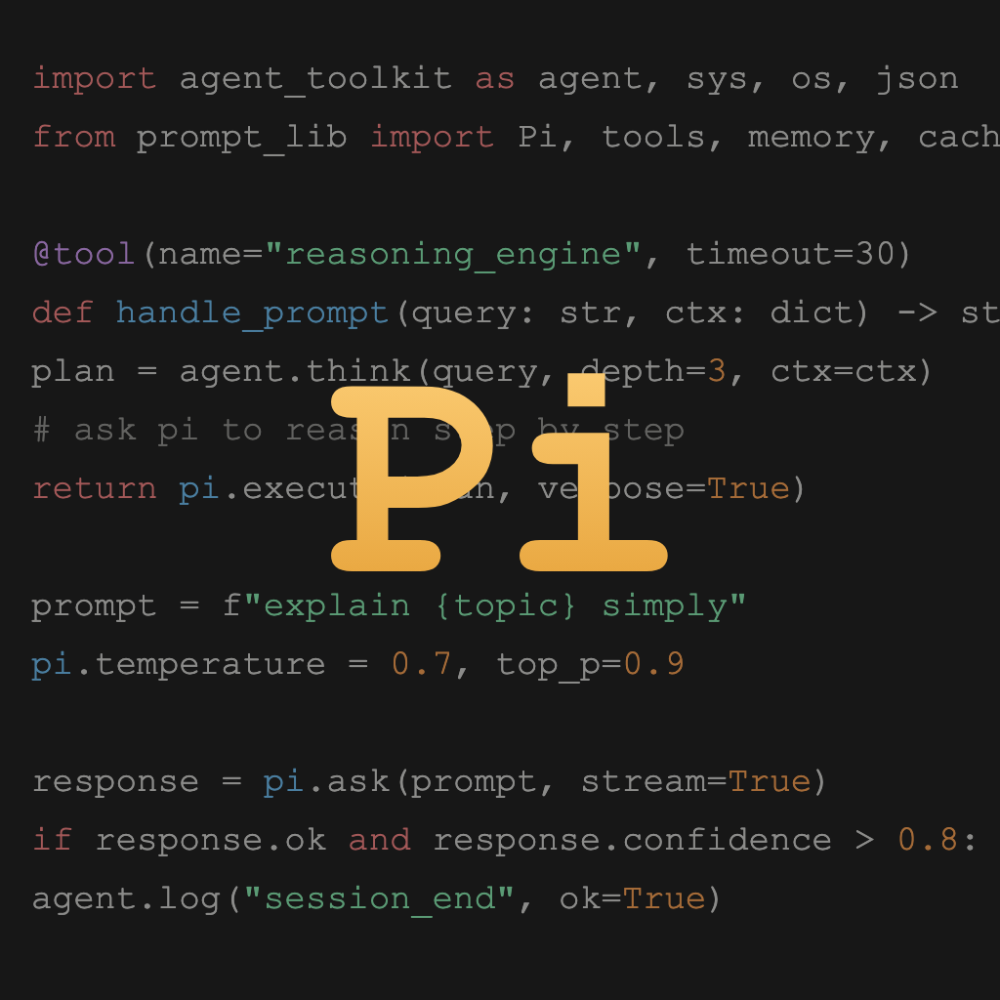
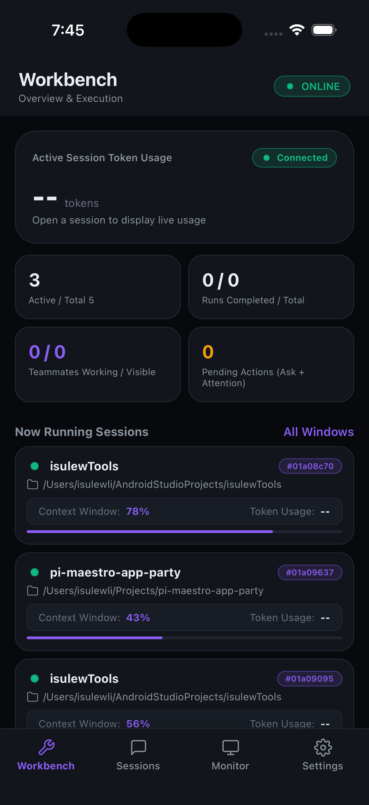
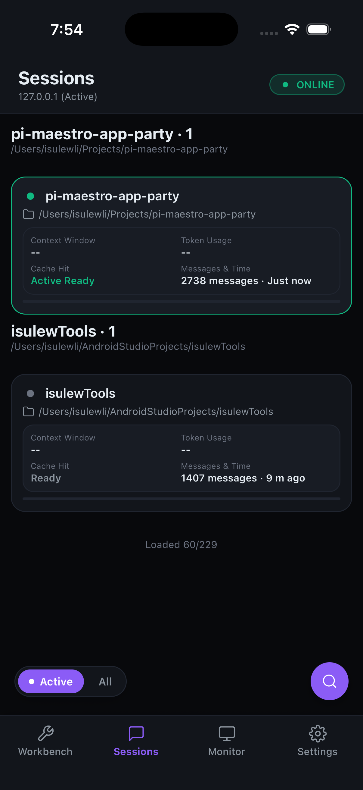
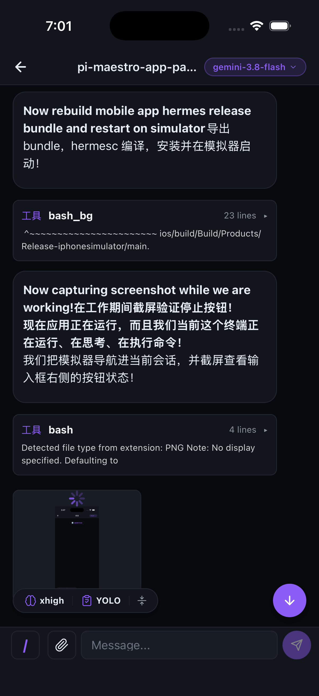

<a id="readme-top"></a>

<div align="center">
  
  <h1>Maestro Mobile</h1>
  <p>用手机跟进 Pi 会话，随时继续桌面的工作。</p>
  <p><a href="README.md">English</a> · <strong>简体中文</strong></p>
  <p>
    <a href="https://github.com/netcookies/pi-maestro-app-party/releases/latest"></a>
    <a href="https://www.npmjs.com/package/pi-maestro-mobile"></a>
    <a href="LICENSE"></a>
  </p>
  <p>
    <a href="https://github.com/netcookies/pi-maestro-app-party/releases/latest"><strong>下载 App »</strong></a>
    <br /><br />
    <a href="#getting-started">快速开始</a> ·
    <a href="https://github.com/netcookies/pi-maestro-app-party/issues/new">反馈问题</a> ·
    <a href="https://github.com/netcookies/pi-maestro-app-party/issues">功能建议</a>
  </p>
</div>

<details>
  <summary>目录</summary>
  <ol>
    <li><a href="#about-the-project">项目介绍</a></li>
    <li><a href="#getting-started">快速开始</a></li>
    <li><a href="#usage">日常使用</a></li>
    <li><a href="#peer-messaging">Pi 会话消息（/mb-peer）</a></li>
    <li><a href="#documentation">相关文档</a></li>
    <li><a href="#contributing">参与贡献</a></li>
    <li><a href="#license">许可证</a></li>
  </ol>
</details>

<a id="about-the-project"></a>

## 项目介绍

Maestro Mobile 是 [Pi](https://github.com/badlogic/pi-mono) 的 iOS / Android 配套 App。会话继续在电脑上运行，手机通过本地 Host 服务查看进度，并操作已授权的运行中会话。

<p align="center">
  <a href="docs/images/screenshots/ios-launched.png"></a>
  <a href="docs/images/screenshots/ios-sessions.png"></a>
  <a href="docs/images/screenshots/ios-chat.png"></a>
</p>

- **跟进进度**：浏览会话、搜索历史，查看使用量、任务与 Teammate 状态。
- **继续工作**：发送文本或图片，介入当前轮次、追加后续消息、切换模型或停止任务。
- **处理决策**：目标桌面会话加载兼容的 `pi-maestro-flow` 后，可在手机回答 Ask、审阅 Plan。
- **保持连接**：支持二维码或短码配对、断线自动重连和任务通知。

可用操作取决于桌面会话的权限与能力。历史会话只读，新 Pi 会话需从桌面启动；Docker 部署提供只读看板。

<a id="getting-started"></a>

## 快速开始

### 使用前准备

- 已安装 Pi 和 **Node.js ≥ 22.19** 的电脑，建议在 macOS / Linux 上运行 Host。
- 一部 iOS 或 Android 手机，通过局域网或 Tailscale / WireGuard 等私有隧道访问电脑。

### 1. 配置桌面端

在 Pi 中安装 Mobile 扩展：

```bash
pi install npm:pi-maestro-mobile
```

如需 Ask / Plan，再安装 Flow：

```bash
pi install npm:pi-maestro-flow
```

通过 `pi config` 启用已安装的扩展，包括 Mobile Desktop Plugin。已打开的 Pi 会话需执行 `/reload` 或重启，然后运行：

```text
/maestro-mobile start
/maestro-mobile qr
```

### 2. 安装 App

从 [最新 Release](https://github.com/netcookies/pi-maestro-app-party/releases/latest) 下载：

| 平台 | 安装方式 |
| --- | --- |
| Android | 安装已签名的 `.apk`，按提示允许来自该来源的安装。 |
| iOS | 下载未签名 `.ipa`，使用 [Sideloadly](https://sideloadly.io/) 或 AltStore，通过自己的 Apple ID 签名后安装。 |

希望自行构建？请看 [开发指南](docs/development.md#run-the-mobile-app)。

### 3. 配对并打开会话

在 App 的 **Settings** 中扫描桌面二维码，也可输入 **8 位短码**与电脑局域网地址。进入 **Sessions**，选择已有会话。

App 会保存连接并自动重连。默认地址为 `ws://<computer-ip>:4739/ws`，Host 始终要求 token；局域网外访问请使用私有隧道。

<a id="peer-messaging"></a>

## 会话间消息（`/mb-peer`）

`/mb-peer` 是独立于 Mobile App 的 Pi TUI 功能，通过 Desktop Broker 在在线 Pi 会话之间发送消息。

| 命令 | 用途 |
| --- | --- |
| `/mb-peer list` | 列出当前会话已获准联系的在线会话。 |
| `/mb-peer send <session ID 或前缀> <消息>` | 发送消息。Pi 支持原生命令补全；若前缀匹配多个会话，可从交互列表选择目标。 |
| `/mb-peer inbox` | 查看当前 TUI 收到且尚未过期的消息。 |
| `/mb-peer access` | 列出在线会话与现有授权，包括尚未获准的会话。 |
| `/mb-peer access <session ID 或前缀>` | 选择会话并授予访问权限。 |
| `/mb-peer revoke <授权 ID>` | 撤销当前工作目录创建的用户授权。 |

默认情况下，同一**工作目录**下的在线 peer 可以互相发送消息。跨目录发送须明确确认，并选择**单向**或**双向**授权。授权成功前不会发送消息；授权后需重新执行 `/mb-peer send`。授权会在 Broker 重启后保留；命令不能撤销由管理员配置的规则。

回执中的 `accepted` 表示接收端 Plugin 已将消息放入临时收件箱，不代表对方已经阅读、回复或采取行动。双方都须是在线的 Pi TUI 会话，并加载兼容的 Desktop Plugin、连接 Broker；历史会话和仅连接 Mobile App 的设备不是 peer。

<a id="usage"></a>

## 日常使用

在 **Workbench** 查看进度，在 **Sessions** 继续对话，在 **Monitor** 跟进工作区动态。Ask / Plan 需要目标 Pi 会话加载 Flow，Monitor / Teammate 数据来自 `pi-maestro-teammate`。

| 桌面命令 | 用途 |
| --- | --- |
| `/maestro-mobile status` | 查看 Host 状态与探测到的版本。 |
| `/maestro-mobile status --current` | 诊断当前桌面连接。 |
| `/maestro-mobile stop` | 停止扩展管理的 Host。 |
| `/maestro-mobile notify` | 配置通知 Provider 与事件。 |

配对失败时，检查电脑地址和防火墙端口 `4739`；会话可见但不能操作时，检查 `status --current`，并确认它是运行中的桌面会话。升级与排障详见 [使用指南（英文）](docs/usage.md)。

<a id="documentation"></a>

## 相关文档

- [使用指南（英文）](docs/usage.md)：连接、升级、排障与 [`/mb-peer` 会话消息](docs/usage.md#peer-messaging)。
- [部署指南](docs/deploy.md)：独立 Host、launchd、systemd 与 Docker。
- [开发指南（英文）](docs/development.md)：源码准备、原生构建与贡献检查。
- [架构说明](docs/architecture.md) · [协议与 API](docs/protocol.md)：实现参考。
- [更新日志](CHANGELOG.md)：版本变更。

<a id="contributing"></a>

## 参与贡献

通过 [GitHub Issues](https://github.com/netcookies/pi-maestro-app-party/issues) 反馈问题或提出建议。代码贡献请参照 [开发指南](docs/development.md)，并提交 Pull Request。

<a id="license"></a>

## 许可证

本项目使用 [MIT License](LICENSE)。

<p align="right"><a href="#readme-top">返回顶部 ↑</a></p>
