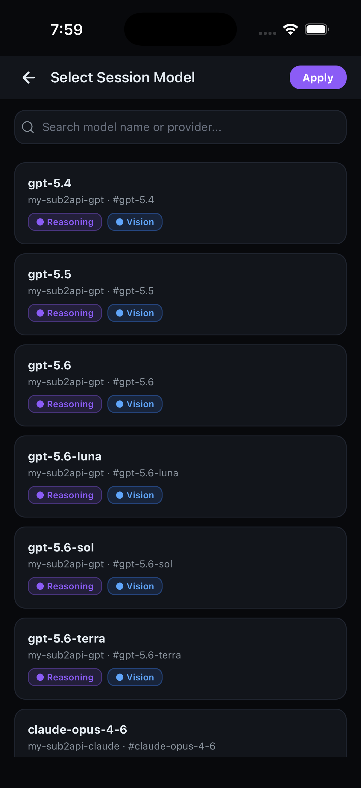
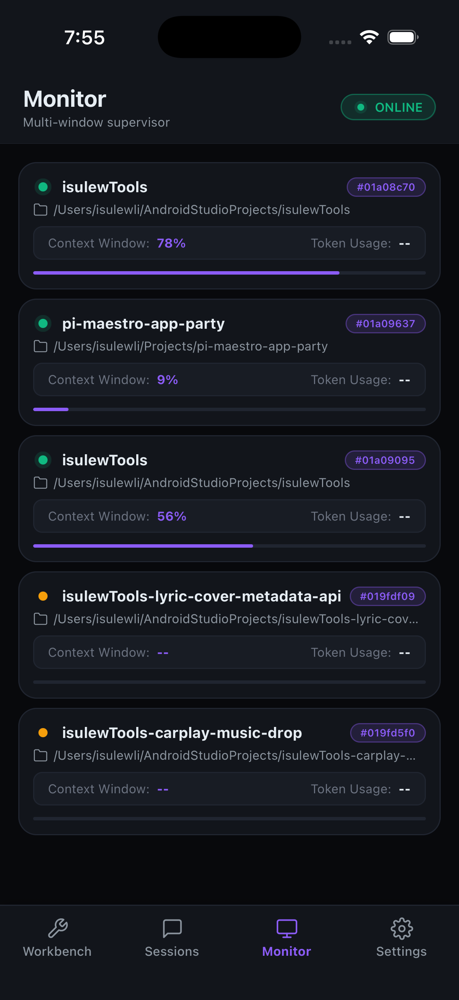
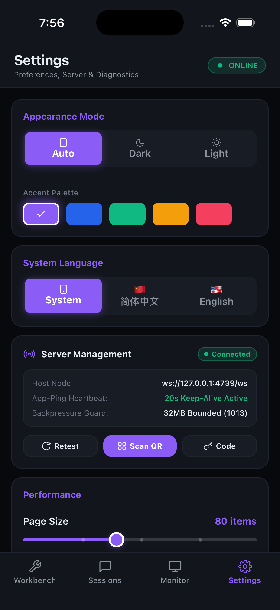

# User guide

[README](../README.md) · [中文首页](../README.zh-CN.md)

For installation and first pairing, start with [Getting started](../README.md#getting-started).

## Sessions and controls

- **Workbench** summarizes usage, runs, teammates, questions and items needing attention.
- **Sessions** lets you search and filter existing sessions, browse paginated history and search past messages.
- In an authorized live session, you can send text or images, steer the current turn, queue a follow-up, choose models and thinking levels, use skills, compact context or abort work.
- Ask supports single-choice, multiple-choice and text answers; Plan lets you review and confirm desktop requests. Both require compatible `pi-maestro-flow` loaded in the target Pi TUI.
- **Monitor** shows workspace activity made available by the server. Teammate telemetry requires `pi-maestro-teammate` and its workspace data.

Actions depend on the target session's advertised capabilities and authorization. History is read-only, and the app does not create new Pi sessions. Docker provides only a dashboard and history, with the relevant data mounted.

<details>
  <summary>More screenshots: models, Monitor and settings</summary>

<p align="center">
  <a href="images/screenshots/ios-model-select.png"></a>
  <a href="images/screenshots/ios-monitor.png"></a>
  <a href="images/screenshots/ios-settings.png"></a>
</p>

</details>

## Connection and permissions

Run `/maestro-mobile qr` in Pi and scan it from **Settings**. If scanning is unavailable, enter the 8-character short code and the computer's LAN address. The app saves the endpoint and token and restores its snapshot after reconnecting.

The default endpoint is `ws://<computer-ip>:4739/ws`. Host listens on `0.0.0.0:4739` and always requires a token; when none is supplied, it generates one and saves it to `~/.pi/maestro-mobile-token`. For localhost-only access, use `--host 127.0.0.1`. For access outside your LAN, use Tailscale / WireGuard.

Camera, photo-library and notification permissions support QR pairing, image prompts and task alerts. Notifications include local alerts, in-app banners and haptic feedback; `/maestro-mobile notify` configures notification providers and events.

## Desktop commands

| Command | Purpose |
| --- | --- |
| `/maestro-mobile start` | Start the Host in the background; skip startup if it is already running. |
| `/maestro-mobile status` | Show Host status, port and detected Pi / Flow / CLI versions. |
| `/maestro-mobile status --current` | Compare the current Pi, Plugin, Broker and Host connection. |
| `/maestro-mobile qr` | Show the QR code, short code and candidate addresses. |
| `/maestro-mobile stop` | Stop the extension-managed Host. |
| `/maestro-mobile notify` | Configure notification providers and events. |

The Host is a separate persistent process and continues after a Pi session closes. A Host managed by launchd or systemd must be stopped with its service manager.

## Updates

1. Stop the Host with `/maestro-mobile stop`, or use its service manager.
2. Update the extensions installed through Pi:

   ```bash
   pi update npm:pi-maestro-mobile
   ```

   If you also installed Flow:

   ```bash
   pi update npm:pi-maestro-flow
   ```

3. Run `/reload` or restart each target Pi TUI. Then run `/maestro-mobile start` and `/maestro-mobile status --current`.
4. Install the updated phone app from [Releases](https://github.com/netcookies/pi-maestro-app-party/releases/latest).

For an npm-global Host, run `npm install -g pi-maestro-mobile`; for source deployments, rebuild. Desktop Plugin protocol v1 cannot connect to the current v2 service: reload or restart the old TUI after upgrading.

## Troubleshooting

| Symptom | What to check |
| --- | --- |
| Phone cannot connect | Check the computer's address, network reachability and firewall port `4739`. An unauthenticated `401` from `/api/health` also proves the service is listening. |
| Session is visible but controls are unavailable | Confirm the desktop session is running with the Mobile Desktop Plugin enabled, then check `status --current`. History and Docker dashboards are read-only. |
| Ask / Plan is missing | Enable Flow's main extension in `pi config`, then `/reload` or restart the target TUI. A dependency warning means Flow compatibility has not been established; basic commands still work. |
| Monitor has no windows | Check `~/.pi/teammate/workspaces/` for owner telemetry and confirm the desktop session has used teammate. |
| Version information is stale | Updating files does not reload extensions in memory. Reload / restart Pi and, if necessary, restart the Host. Empty host-version fields inside Docker are expected. |

Host logs are at `~/.pi/maestro-mobile.log` and may contain tokens; redact them before sharing. Version detection is diagnostic and does not grant capabilities. More service and Docker troubleshooting is in the [deployment guide (中文)](deploy.md).
